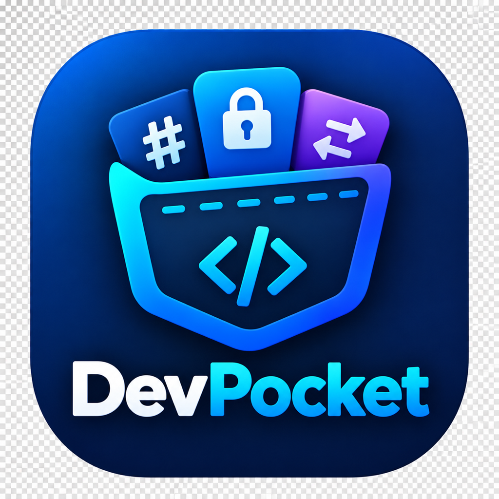

# DevPocket

<p align="center">
  <strong>A pocket-sized toolkit for developers.</strong>
  <br />
  A lightweight desktop application that brings everyday developer utilities into one clean, fast, and convenient workspace.
</p>

<p align="center">
  
</p>

<p align="center">
  
  
  
  
  
</p>

---

## Overview

**DevPocket** is a desktop toolkit designed to make common development tasks easier without switching between websites, command-line utilities, and separate applications.

From number conversion and data encoding to cryptographic operations and formatting, DevPocket provides a growing collection of practical tools in one organized workspace.

The application focuses on a compact interface, straightforward workflows, and a consistent user experience across its tools.

## Features

### Developer Utilities

- **Number Converter** — Convert between decimal, hexadecimal, binary, and octal representations.
- **Encoding & Decoding** — Work with Base64, Base64URL, UTF-8, and hexadecimal data.
- **JSON Formatter** — Format and minify JSON, validate input, and copy results.
- **GUID Generator** — Generate unique UUID v4 identifiers in multiple formats, with configurable output.
- **Color Converter** — Convert between common color representations, including HEX, RGB, HSL, HSV, and CMYK.
- **RSA Encryption & Decryption** — Perform RSA cryptographic operations with supported padding options.
- **OTP Generator** — Generate time-based one-time passwords using configurable settings.

The available toolset evolves as development progresses.

### User Experience

- Clean, compact desktop interface.
- Categorized sidebar for navigating tools.
- Searchable tool navigation.
- Light and dark themes.
- Consistent input fields, validation, and clipboard interactions.
- Responsive layouts for different window sizes.

## Tech Stack

| Technology | Purpose |
|---|---|
| [Go](https://go.dev/) | Native application backend |
| [Wails v3](https://wails.io/) | Desktop application framework |
| [React](https://react.dev/) | User interface |
| [TypeScript](https://www.typescriptlang.org/) | Type-safe frontend development |
| [Material UI](https://mui.com/) | UI components and theming |
| [Vite](https://vite.dev/) | Frontend development and bundling |

## Getting Started

### Prerequisites

Before running DevPocket from source, install:

- [Go](https://go.dev/dl/)
- [Node.js](https://nodejs.org/) and npm
- [Wails CLI v3](https://wails.io/docs/gettingstarted/installation)

Platform-specific build dependencies may also be required. On Windows, ensure that the WebView2 Runtime and the required C/C++ build tools are available.

### Installation

Clone the repository:

```bash
git clone <repository-url>
cd DevPocket
```

Install frontend dependencies:

```bash
cd frontend
npm install
cd ..
```

### Development

Start the Wails development environment from the project root:

```bash
wails3 dev
```

This starts the application with the development workflow enabled.

### Build

Build the desktop application for the current platform:

```bash
wails3 build
```

For a clean build:

```bash
wails3 build -clean
```

Build output and platform-specific resources are managed by the Wails build configuration.

## Project Structure

```text
DevPocket/
├── build/                  # Application icons and build resources
│   └── appicon.png
├── frontend/
│   ├── src/
│   │   ├── components/     # Shared UI components
│   │   ├── data/            # Tool definitions and metadata
│   │   ├── tools/           # Developer utilities
│   │   ├── App.tsx          # Application shell
│   │   └── ...
│   ├── package.json
│   └── ...
├── main.go                 # Go application entry point
├── wails.json              # Wails configuration
└── README.md
```

*The structure above is illustrative; directory names may vary as the project evolves.*

## Design Principles

DevPocket is built around a few simple principles:

- **Practicality over complexity** — Tools should be easy to find and use.
- **One workspace** — Common development utilities belong together.
- **Consistency** — Shared UI patterns keep tools familiar.
- **Lightweight by design** — Prefer a focused desktop experience over an unnecessarily heavy application.
- **Continuous improvement** — Add tools based on real developer needs.

## Roadmap

Planned improvements include:

- [ ] Hash calculation for text and files.
- [ ] Image format conversion.
- [ ] Further improvements to the tool collection and user experience.
- [X] Migration to Wails v3.

The roadmap may change as development priorities evolve.

## Contributing

Contributions, bug reports, feature requests, and suggestions are welcome.

If you have an idea for a new utility or an improvement to an existing one:

1. Check the existing issues.
2. Open an issue describing the problem or proposed feature.
3. Submit a pull request with a focused change.

For larger changes, opening an issue first helps align the implementation with the project's direction.

## License

The project's license has not yet been specified. Licensing information will be added when the repository's distribution terms are finalized.

---

<p align="center">
  <strong>DevPocket</strong>
  <br />
  <sub>Everyday developer tools. One desktop app.</sub>
</p>